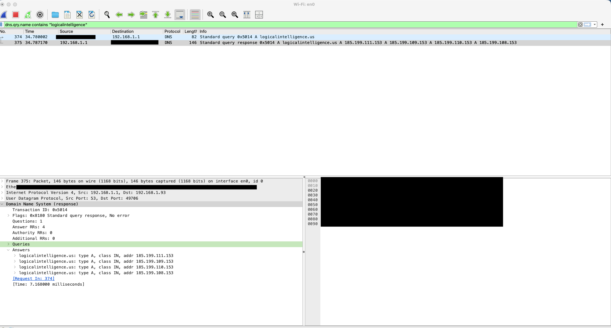
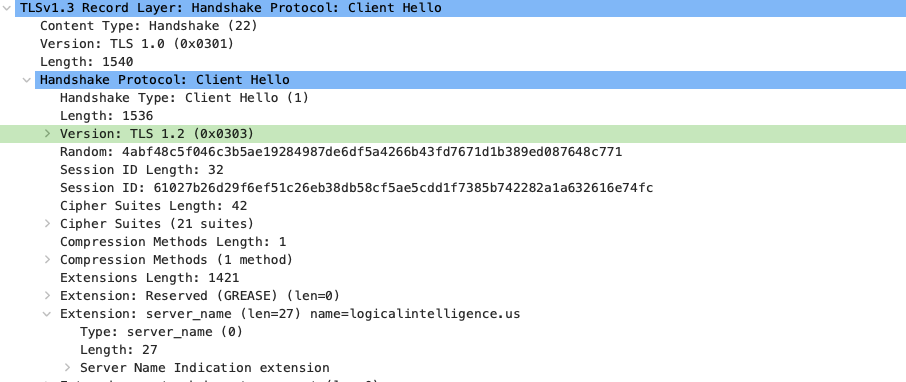

# Day 1: Wireshark and the Linux command line

## What I did
Captured my own network traffic on my Mac in Wireshark while loading logicalintelligence.us, then stopped the capture and filtered it.

## DNS
I ran nslookup logicalintelligence.us while capturing. Wireshark showed a DNS query asking for the site’s address and a response, with the same ID, that returned four IP addresses (185.199.108.153, 185.199.109.153, 185.199.110.153, 185.199.111.153) in about 7 ms.

## TLS handshake
In the Client Hello, the server_name extension showed logicalintelligence.us in plain text. My browser also offered 21 cipher suites.

## Encrypted stream
Following the TCP stream showed mostly unreadable characters, because the data after the handshake is encrypted. Only the handshake, like the site name in the Client Hello, was visible.

## Screenshots

## What I learned
I learned that DNS lookups and the site name in a TLS handshake are visible on the network, but the page content isn’t. I also found that my browser and extensions make lots of DNS requests I wasn’t expecting, like the ones for Honey. Even though I used Wireshark in school, I didn’t realize the amount of traffic that goes through a single home Wi-Fi network until I captured my own.